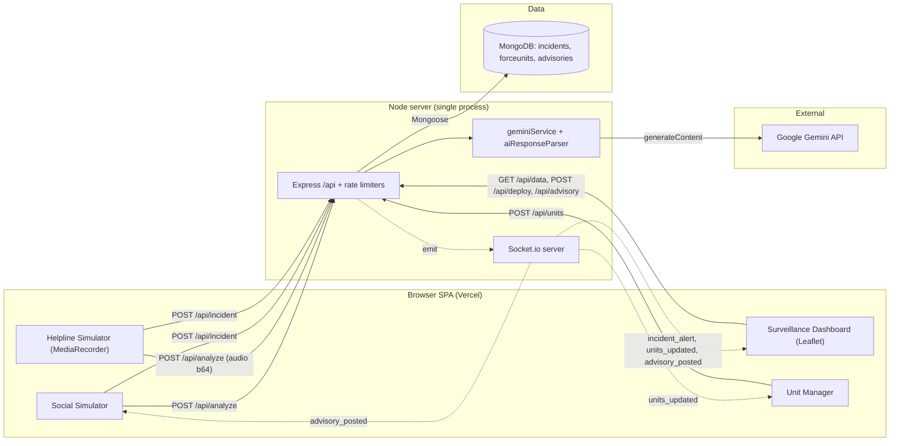
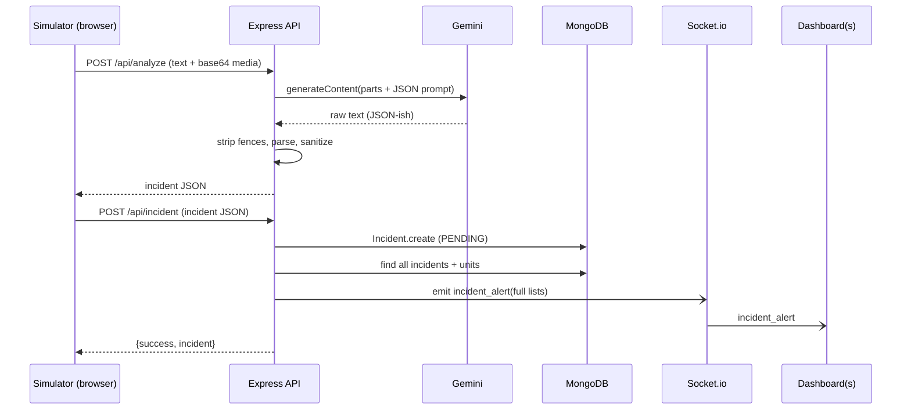
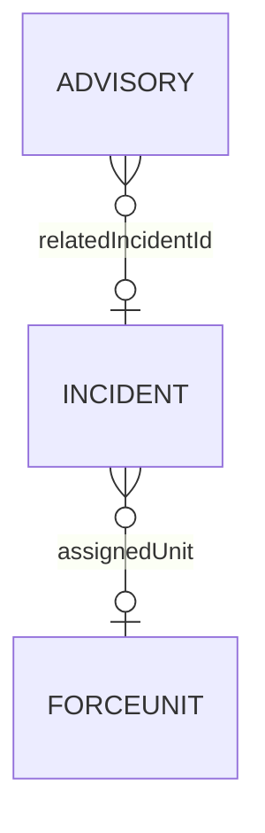

# ARGUS.AI — Architecture Walkthrough

> Generated from: `rishabhhs17/argus.ai` at commit `bff824d` ("DEPLOYMENT READY"). Claims tagged `(inferred)` were not directly verified in code.

## 1. TL;DR

- **Problem:** During a disaster, control rooms get flooded with unstructured citizen reports (posts, photos, voice calls) and can't triage or locate them fast enough.
- **Core idea:** Send every raw report through one LLM call (Gemini) that returns a fixed JSON incident record (type, severity, coordinates, evidence, action plan), store it, and push it to every open dashboard over WebSockets so an operator can dispatch the nearest unit.
- **Stack:** React 18 + Vite + Tailwind + Leaflet SPA (Vercel) → Node/Express + Socket.io single server → MongoDB (Mongoose) + Google Gemini (`gemini-2.5-flash` by default).

## 2. The problem

| Aspect | Detail |
|---|---|
| Who has it | Emergency control-room operators (police / fire / medical dispatch) |
| Pain | Many reports at once, in mixed formats (text, image, audio), with vague locations; checking them by hand is slow |
| Constraints | Low latency from report to map; multimodal input; the operator must see the same live state as everyone else; LLM cost and quota |
| Why the naive approach fails | Reading reports by hand doesn't scale. Keyword/regex parsing can't read images or audio or turn "near the big temple in Connaught Place" into coordinates. Polling dashboards are seconds behind. |

## 3. The solution

Each input channel (social-post simulator, voice-helpline simulator) sends raw media to a backend-for-frontend proxy (`/api/analyze`). The proxy calls Gemini with a strict JSON-schema prompt, then **sanitizes** the model output into a well-formed incident (clamped severity, valid coordinates, string arrays). The client posts that record to `/api/incident`, which saves it in MongoDB and broadcasts the full incident and unit lists to every connected Socket.io client. The dashboard computes nearest idle units client-side (Haversine) and dispatches through `/api/deploy`.

| Constraint | How the design addresses it | Where |
|---|---|---|
| Multimodal input | Media is base64-encoded in the browser and sent to Gemini as `inlineData` next to the prompt | `client/src/services/gemini.ts`, `server/src/services/geminiService.js` |
| Unreliable LLM output | Markdown fences are stripped, the JSON is parsed, and every field is type-checked or replaced with a default; on parse failure → 502 | `server/src/utils/aiResponseParser.js` |
| API key secrecy | Gemini key exists only on the server (BFF) | `server/src/config/env.js` |
| Live shared state | Each mutation emits a Socket.io broadcast to all clients | `server/src/services/realtimeService.js` |
| LLM cost/quota | `/api/analyze` limited to 10 req / 30 min per IP; rest of `/api` 300 / 15 min | `server/src/middleware/rateLimiters.js` |
| Fast initial load | Lazy-loaded routes, one shared socket | `client/src/App.tsx`, `client/src/services/socket.ts` |

## 4. Architecture

## 5. Components

| Component | Responsibility | Tech | Scales how | Evidence |
|---|---|---|---|---|
| Landing page | Marketing / feature overview | React, framer-motion | static | `client/src/components/LandingPage.tsx` |
| Social Simulator | Fake citizen feed: text + image → analyze → incident; shows advisories live | React | static | `client/src/components/SocialSimulator.tsx` |
| Helpline Simulator | Records mic audio, sends it to Gemini, creates incident with `[VOICE CALL]` prefix | MediaRecorder API | static | `client/src/components/HelplineSimulator.tsx` |
| Surveillance Dashboard | Live map, alerts, flash on severity > 7, nearest-unit suggestion, deploy, AI advisory, admin reset | react-leaflet, Haversine | static | `client/src/components/SurveillanceDashboard.tsx` |
| Unit Manager | Place police/fire/medical units on map | react-leaflet | static | `client/src/components/UnitManager.tsx` |
| Express API | 7 REST routes, CORS, 50 MB JSON body, error handler | Express 4 | stateless in principle, but see Socket.io | `server/src/app.js`, `server/src/routes/apiRoutes.js` |
| Realtime service | Module-level `io` singleton; broadcasts to all sockets | Socket.io 4 | **singleton**: no adapter, one instance only | `server/src/services/realtimeService.js` |
| Gemini service | Prompting for incident analysis and advisory drafting | `@google/generative-ai` | bound by Gemini quota | `server/src/services/geminiService.js` |
| AI response parser | Output hardening / defaults | plain JS | pure function | `server/src/utils/aiResponseParser.js` |
| MongoDB | Persistent state for 3 collections | Mongoose 8, Atlas | stateful | `server/models/*.js`, `server/src/config/db.js` |

## 6. Critical flows

### Flow A: Citizen report → incident on map (the core loop)

1. User writes a post and/or attaches an image in Social Simulator (or records audio in Helpline). The browser reads the file with `FileReader` and turns it into base64. *(client, sync)*
2. `POST /api/analyze {text, fileData, mimeType, taskType:'ANALYSIS'}`. Goes through `apiLimiter` and `aiLimiter`. *(sync HTTP)*
3. `geminiService.analyzeIncidentInput` builds `[text, inlineData, prompt]` and calls `generateContent`. *(sync, external, slowest hop)*
4. `parseIncidentAnalysis` strips fences, runs `JSON.parse`, then `sanitizeIncidentAnalysis` (severity clamped to 1–10, coordinates default to New Delhi `[28.6139, 77.2090]`). Returns JSON to the **client**. *No state written.*
5. Client sends `POST /api/incident` with the AI output. *(second sync HTTP round trip)*
6. `Incident.create(... status:'PENDING')`. **State written: MongoDB `incidents`.**
7. Server re-queries **all** incidents (populated) and **all** units, then calls `io.emit('incident_alert', {incidents, units, newIncident})`. *(async push)*
8. Every dashboard replaces its state, shows an alert toast, and flashes red if severity > 7.

### Flow B: Dispatch

1. Operator clicks an incident. Dashboard filters `units` to `IDLE` with valid coordinates, computes Haversine distance, and suggests the nearest POLICE, FIRE, and MEDICAL unit. *(client-only, uses whatever state the client last received)*
2. `POST /api/deploy {incidentId, unitId}` → `Incident.findByIdAndUpdate(status:'DISPATCHED', assignedUnit)` then a **separate** `ForceUnit.findByIdAndUpdate(status:'BUSY')`. **State written: two documents, no transaction, no check that the unit is still IDLE.**
3. Re-query everything → `incident_alert` broadcast.

### Flow C: Public advisory

1. Dashboard sends `POST /api/analyze {taskType:'ADVISORY', text: incident summary}` → Gemini drafts a message under 280 characters.
2. The client **immediately** posts it to `POST /api/advisory`; the operator never sees an edit/approve step. → `Advisory.create` → `advisory_posted` broadcast → Social feed shows it.

### Flow D: Admin reset

`DELETE /api/clear` with `x-admin-key` header. The key is compared to `ADMIN_KEY` with `!==`. The server deletes incidents and advisories, sets all units to IDLE, then broadcasts empty state. This is the only authenticated route.

## 7. Data model & storage

| Entity | Store | Key fields | Access pattern | Index | Retention |
|---|---|---|---|---|---|
| Incident | Mongo `incidents` | type, severity, location{address, coordinates[lat,lng]}, breakdown{...}, action_plan, status, assignedUnit | Full scan + populate + sort by timestamp on every write and every `/api/data` | `timestamp` | Forever (until admin reset) |
| ForceUnit | Mongo `forceunits` | name, type (POLICE/FIRE/MEDICAL), status (IDLE/BUSY), coordinates | Full scan on every write | none | Forever; units never return to IDLE except via reset |
| Advisory | Mongo `advisories` | message, author, timestamp, relatedIncidentId (never set) | Latest 50 | `timestamp` | Forever (until reset) |

Notes: no enums or `required` on any schema; `coordinates` is a plain `[Number]`, not GeoJSON with a `2dsphere` index, so the database can't run a nearest-unit query.

## 8. Tech stack & rationale

| Tech | Role | Why this | Alternative | Alternative wins when |
|---|---|---|---|---|
| Gemini 2.5 Flash | Multimodal extraction (text, image, audio in one call) | One API handles all three modalities, it's cheap and fast, and has a free tier | Separate STT (Whisper) + vision + text LLM; or Claude / GPT-4o | You need per-stage accuracy, auditability, or provider redundancy |
| Prompted JSON + hand-written sanitizer | Structured output | Simple, works across SDK versions | Gemini `responseSchema` / JSON mode, or Zod validation | You want the model to be held to the schema, not just repaired after the fact |
| Express | REST API | Familiar, minimal | Fastify, NestJS | Throughput or built-in schema validation matters |
| Socket.io | Server → client push | Rooms, reconnect, fallbacks for free | SSE (one-way is all that's used here) | You only push one way and want plain HTTP and easy proxying |
| MongoDB + Mongoose | Persistence | Nested AI output maps directly to documents; Atlas free tier | Postgres + PostGIS | Need transactions across incident+unit, geo queries, and constraints |
| React + Vite + Tailwind | SPA | Fast dev loop, lazy routes | Next.js | Need SSR or co-located API routes |
| Leaflet / react-leaflet | Map | Free, OSM tiles, no key | Mapbox / Google Maps | Need routing/ETA, traffic, vector tiles |
| express-rate-limit | Cost control | One line | Redis-backed limiter, API gateway | More than one server instance |
| Vercel (client) + separate Node host | Hosting | Static SPA on CDN; WebSockets need a long-lived server | Single container serving both | You want one deploy and same-origin cookies |

## 9. Trade-offs

| Decision | Chosen | Rejected | Gained | Paid |
|---|---|---|---|---|
| Where AI runs | Server-side BFF proxy | Gemini called from the browser | Key never ships to clients | Every media byte goes through your server (50 MB body limit) |
| Who persists the AI result | Client round trip: analyze → client → `/incident` | Server saves it right after analysis | Simulators can tweak the payload (e.g. `[VOICE CALL]` prefix) | Two round trips; **anyone can POST a forged incident and skip the AI**; the analysis is lost if the second call fails |
| Broadcast shape | Full incidents + units list on every change | Delta events (`incident_created {incident}`) | Clients can never drift; trivial client code | O(N) DB reads + O(N × clients) bytes on every write |
| Dispatch logic | Client-side Haversine on cached state | Server-side `$near` query + atomic claim | No server geo code | Stale state → two operators can assign the same unit; straight-line ≠ travel time |
| Output schema | Prompt + sanitize with defaults | Strict reject | Never crashes on partial output | Garbage turns into plausible data (unknown location → pin at central New Delhi) |
| Advisory publishing | Auto-post the AI draft | Human review step | One click | An LLM writes directly to the public feed |
| Auth | None except admin key on reset | JWT / sessions / roles | Demo has no friction | Every write endpoint is public |

## 10. Non-functional review

| Dimension | Current state | Gap | Evidence |
|---|---|---|---|
| Scalability | One Node process; Socket.io with no adapter; in-memory rate limiter | Can't run 2 replicas: broadcasts and limits stay per-instance | `server/index.js`, `rateLimiters.js` |
| Reliability | DB connect errors are logged and swallowed, so the server comes up "healthy" without a DB; `/health` doesn't check Mongo | Requests then hang until Mongoose's buffer timeout (inferred) | `server/src/config/db.js`, `app.js` |
| Consistency | Deploy = 2 separate writes, no IDLE precondition | Double dispatch; incident DISPATCHED while unit write failed | `unitController.js` |
| Security | CORS `*` (HTTP + socket), no auth on create/deploy/units/advisory, `ForceUnit.create(req.body)` mass assignment, admin key compared with `!==` and entered via `prompt()` | Anyone can spoof incidents, dispatch units, post "official" advisories | `app.js`, `apiRoutes.js`, `unitController.js` |
| Observability | `console.log/error` only | No request IDs, no Gemini latency/token metrics, no error tracking | throughout |
| Performance | `/api/data` returns all incidents unbounded; status sidebar uses `/api/data` as health ping | Grows linearly; health check costs a full DB read and uses rate-limit budget | `dataController.js`, `SystemStatusSidebar.tsx` |
| Testing | None; no test script, no CI | Parser and controllers untested | `server/package.json` |

## 11. Failure modes

| Dependency | Dies | Slow | Duplicates / reorders | Handled? |
|---|---|---|---|---|
| Gemini | 500 "AI Analysis Failed"; report is lost (no retry/queue) | Request hangs as long as Gemini does: no timeout set | User double-clicks → 2 incidents (no idempotency key) | ⚠️ |
| Gemini bad output | Parse error → 502; partial output → defaults inserted silently | — | — | ⚠️ (doesn't crash, but writes made-up defaults) |
| MongoDB | Startup error swallowed; API calls error/hang | Every write does 3 queries, so it slows 3× | Concurrent deploys both succeed | ❌ |
| Socket.io connection | Client stops getting updates; no re-fetch on `reconnect`, so the dashboard silently goes stale | — | Full-state payloads make reordering mostly harmless | ⚠️ |
| Server restart / cold start | Free-tier host sleeps (commit `6abf35f` "health route to fix cold start") (inferred host) | First request takes seconds | — | ⚠️ |
| Mic / audio | MediaRecorder output is usually WebM/Opus but is labeled `audio/mp3` (inferred from browser defaults) | — | — | ⚠️ mislabeled MIME may break or degrade Gemini audio parsing |

## 12. Claimed vs implemented

| Claim (README) | Reality in code | Risk |
|---|---|---|
| Helpline "uses the **Web Speech API** to … transcribe" | Uses `MediaRecorder` and sends raw audio to Gemini; no Web Speech API, and no transcript is stored | Interviewer asks "how does transcription work?" |
| "Google Gemini **1.5 Flash** (via **@google/genai** SDK)" | Default model `gemini-2.5-flash`; server imports the **legacy** `@google/generative-ai`. `@google/genai` is installed on both sides but unused | Looks careless; the client bundle carries an unused SDK + `dotenv` |
| "Smart Dispatch calculates distances and assigns the nearest available unit" | Suggests nearest per type on the client; the operator still clicks; server doesn't verify availability | "Assigns" overstates it; race condition |
| "Secure Architecture" | Only the Gemini key is protected; all write routes are unauthenticated, CORS `*` | Biggest landmine |
| "Auto-Geolocation extracts coordinates" | LLM guesses lat/lng; failures fall back to central New Delhi without a flag | Wrong pins look authoritative |
| `Advisory.relatedIncidentId` "link to incident" | Never populated | Minor |

## 13. Scale-up path

| Load | What breaks first | Fix |
|---|---|---|
| 10× (hundreds of incidents, tens of dashboards) | `incident_alert` sends the full list on every write; `/api/data` unbounded; Gemini rate limit (and the per-IP limiter, which behind a proxy may lump all users together without `trust proxy`, inferred) | Delta events; paginate/limit to active incidents; `app.set('trust proxy', 1)`; queue Gemini calls |
| 100× (real city, many simultaneous reports) | Single process; synchronous Gemini in the request path; no dedupe of the same event reported 200 times | Job queue (BullMQ/Redis) for analysis with retries; Socket.io Redis adapter + N replicas; server-side clustering/dedupe of incidents by geo+time+type with embeddings; PostGIS or Mongo `2dsphere` for dispatch |

## 14. Improvements (ranked by impact ÷ effort)

| # | Problem (evidence) | Fix | Effort | Verify by |
|---|---|---|---|---|
| 1 | Double dispatch race (`unitController.deployUnit`) | `ForceUnit.findOneAndUpdate({_id, status:'IDLE'}, {status:'BUSY'})`; if it returns null → 409; only then update the incident (or a Mongo transaction) | S | Fire 2 parallel deploys of the same unit in a test; expect one 200 and one 409 |
| 2 | Forged incidents bypass AI; extra round trip (`/api/incident` trusts client) | Have `/api/analyze` persist + broadcast directly (pass `source: 'social'|'voice'`); remove or auth-protect `/api/incident` | S | `curl` to `/api/incident` is rejected; e2e report still shows on map |
| 3 | No auth on writes; CORS `*`; mass assignment in `createUnit` | Restrict CORS to the Vercel origin; operator auth (JWT/session) on deploy/units/advisory/clear; whitelist unit fields; `crypto.timingSafeEqual` for admin key | M | Unauthenticated requests → 401; supertest suite |
| 4 | Silent fallback to New Delhi coordinates (`aiResponseParser.js`) | Return `coordinates: null` + `location_confidence`; dashboard lists unlocated incidents separately instead of pinning them | S | Parser unit test with missing coords |
| 5 | LLM output only repaired after the fact | Use Gemini `responseMimeType: 'application/json'` + `responseSchema`; keep sanitizer as a second line of defense; add request timeout (AbortController) | S | Track parse-failure rate before/after (log counter) |
| 6 | Full-list broadcasts + 3 queries per write | Emit `incident_created`/`incident_updated` with one document; clients merge; re-fetch `/api/data` on socket `connect`/`reconnect` | M | Payload size per event constant as incidents grow; kill/restore network and dashboard catches up |
| 7 | Server boots without DB; `/health` lies | Exit on Mongo connect failure (or retry with backoff); `/health` checks `mongoose.connection.readyState`; sidebar uses `/health` | S | Start with bad `MONGO_URI` → health 503 |
| 8 | Advisory auto-published | Show draft in an editable modal; post only on confirm; set `relatedIncidentId` | S | Manual check; advisory doc has incident link |
| 9 | Units never freed; no incident lifecycle | Add `RESOLVED` status + `/api/resolve` that frees the unit | S | Unit returns to IDLE after resolve |
| 10 | No tests | Jest tests for `aiResponseParser` (fences, bad JSON, clamping) and supertest for deploy/clear with Gemini mocked | M | CI green on PR |

## 15. Interview kit

**60-second pitch**
> During disasters, control rooms drown in unstructured reports: tweets, photos, panic calls. ARGUS.AI is a real-time command center that turns those into structured, geolocated incidents. Any report, text, image, or recorded voice, goes to a Node backend that proxies Google Gemini with a strict JSON schema prompt, then hardens the output (severity clamped 1–10, coordinates validated). Incidents are stored in MongoDB and pushed over Socket.io to every operator's Leaflet map, where the dashboard ranks the nearest idle police, fire, and medical units by Haversine distance for one-click dispatch, and Gemini can draft a public advisory pushed to the citizen feed. The hardest part was making LLM output safe to plot on a map; next I'd move analysis to a queue and make dispatch atomic.

**Likely questions**

| Question | Answer (decision → why → cost → at scale) |
|---|---|
| Why proxy Gemini through your server? | Keeps the API key off the client (BFF) and lets me rate-limit AI calls separately (10/30 min). Cost: media bytes go through my server, hence the 50 MB body limit. At scale I'd upload to object storage and pass a URI. |
| How do you handle the LLM returning bad JSON? | Prompt asks for an exact shape; `aiResponseParser` strips fences, parses, then type-checks every field with defaults; unparseable → 502. Weakness: defaults can hide failures (Delhi fallback). Fix: JSON mode with `responseSchema` + null coordinates with confidence. |
| Why Socket.io and not polling? | Operators need sub-second updates; push avoids N clients polling. Only server→client is used, so SSE would also work. To scale: Redis adapter + sticky sessions. |
| Why broadcast the whole list? | Simplicity and guaranteed consistency for a demo. Cost: O(N) per event. I'd switch to delta events + re-sync on reconnect. |
| How does nearest-unit work? | Client filters IDLE units, Haversine distance, picks min per type. Straight-line distance, not drive time; and since it's on the client, two operators can race. Server-side `$near` with a `2dsphere` index + atomic claim fixes both. |
| What if two operators dispatch the same unit? | Today both succeed; that's a known bug. Fix: conditional `findOneAndUpdate({status:'IDLE'})` → 409. |
| Why MongoDB? | AI output is nested and its schema evolved (breakdown fields were added later), so documents fit. For transactional dispatch and geo queries, Postgres + PostGIS is a strong alternative. |
| How is audio handled? | MediaRecorder captures audio, base64 to server, Gemini analyzes the audio directly in one multimodal call: no separate STT step. (Don't say Web Speech API: the code doesn't use it.) |
| What if Gemini is down or slow? | Request fails, the report is lost, no timeout. Next step: queue with retries and a "pending analysis" incident so nothing is dropped. |
| How would you stop fake reports? | Today anyone can POST `/api/incident`. Move persistence server-side after analysis, add auth for operators, and add corroboration (multiple independent reports clustered by place and time) before raising severity. |
| How do you deduplicate 200 tweets about the same fire? | Not done. Plan: cluster by geo radius + time window + type (or embedding similarity) and attach as evidence to one incident. |

**Numbers to know**

| Metric | Value | Source / how to measure |
|---|---|---|
| AI rate limit | 10 requests / 30 min / IP | `rateLimiters.js` |
| API rate limit | 300 requests / 15 min / IP | `rateLimiters.js` |
| Max request body | 50 MB | `app.js` |
| Severity scale | 1–10, alert flash above 7 | `aiResponseParser.js`, `SurveillanceDashboard.tsx` |
| Advisory length | < 280 chars (prompted, not enforced) | `geminiService.js` |
| Report → map latency (p50/p95) | not measured | Log timestamps at analyze start, Gemini return, insert, emit; run 50 sample reports |
| Gemini extraction accuracy | not measured | Hand-label ~30 reports (type, severity, location) and compare |
| Parse-failure / fallback rate | not measured | Count 502s and default-coordinate hits |
| Concurrent dashboards supported | not measured | k6 or Artillery with socket.io clients |

**Landmines**

| Question that would hurt today | Fix before interview / honest answer |
|---|---|
| "README says Web Speech API: show me." | Fix the README (MediaRecorder + Gemini audio); also fix the `audio/mp3` MIME label to `recorder.mimeType` |
| "It says secure: can I create an incident with curl?" | Yes, today. Do improvements #2 and #3, or say it's a demo with only the AI key protected |
| "What happens with two simultaneous dispatches?" | Ship improvement #1 (≈10 lines) |
| "Where's the incident if the location is unknown?" | Pinned at central New Delhi silently. Do improvement #4 |
| "Any tests?" | None. Add parser unit tests at minimum (improvement #10) |
